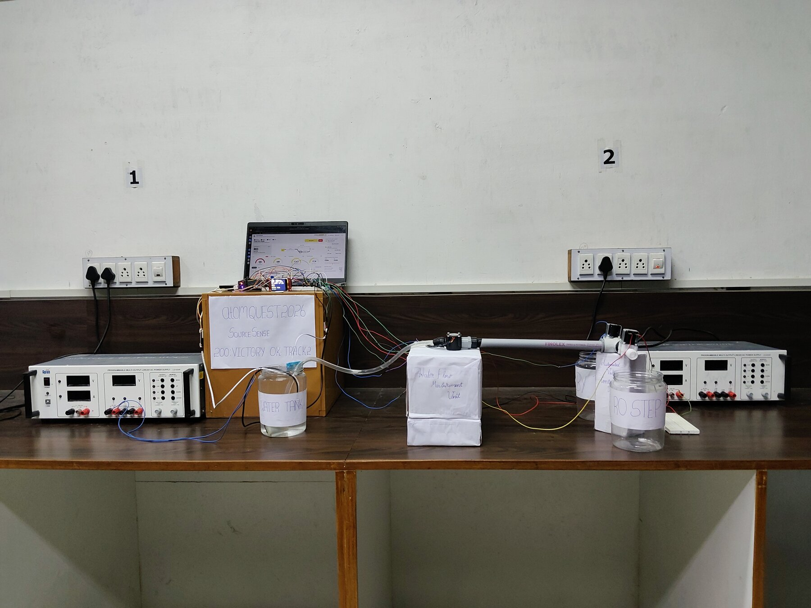

# SourceSense

Inlet water sensing beyond TDS, so that an adaptive water purifier knows when it is actually safe to skip RO.

**atomQUEST 2026, Round 2 | Track 2: Water Purifier | Area: Input water quality sensing beyond TDS**
Team 200: Victory OK (SANMUGAVEL B, SANJEEVI SRIRAM G), Madras Institute of Technology, Anna University, Chennai

| Link | |
|---|---|
| Demo video | to be added |
| SOLIDWORKS model in 3D (opens in a browser, no install) | https://sanmugavel1.github.io/SourceSense-atomQUEST2026/ |
| Dashboard (needs the rig, or press Demo for simulated values) | https://sanmugavel1.github.io/SourceSense-atomQUEST2026/dashboard.html |

## The problem

Adaptive purifiers skip RO when inlet TDS is below about 300 ppm. A TDS probe only measures conductivity, so a low reading does not mean safe water. A home can move to tanker or borewell water, the TDS can stay under 300, and the purifier still sends that water around the RO membrane.

## The idea

SourceSense learns what this home's normal treated water looks like, then asks "does this water still look like that?" every time. RO is skipped only when every check passes. Anything else, including a failed sensor, goes to RO.

## What runs on the bench today

Water sits in a tank jar with the sensors. The ESP32 measures, decides, and opens one of two normally closed 12 V valves. A hand-switched pump then pushes the water through a YF-S201 flow sensor to the RO jar or the bypass jar. The result shows on a 1.8 inch TFT and on a Web Serial dashboard on the laptop.

| Real, measured on the rig | Not real yet |
|---|---|
| TDS, temperature, turbidity (relative clearness), flow pulses, valve routing | ORP is typed in by hand and marked MAN. We could not procure the electrode this round. |

The output jars hold no real RO or UV stage. This rig does not make drinking water.

## Results recorded so far

These are single runs from our demo video, read off the screen. Full log in [docs/TEST_LOG.md](docs/TEST_LOG.md).

| Situation | TDS (ppm) | ORP typed (mV) | Clearness (%) | Route | Reason on screen |
|---|---|---|---|---|---|
| Normal water, after learning | 95 | 680 | 100.2 | BYPASS | SAFE |
| Salt added, still far below 280 ppm | 142 | 680 | 99.7 | RO | SOURCE CHANGE |
| Chlorine missing (typed value) | 159 | 380 | 100.4 | RO | NO CHLORINE |
| Turbid water sample | 509 | 680 | 94.3 | RO | HIGH TDS |
| Temperature probe failed (-127 C) | 154 | 680 | 99.8 | RO | FAULT:TEMP |

The second row is the point of the project. A plain TDS > 300 rule would have bypassed that water.

The earlier figure of unsafe litres falling from 7.7% to under 0.1% comes from our Round 1 simulation of 1000 synthetic homes. It is not a hardware result.

## Repository layout

| Folder | Contents |
|---|---|
| `firmware/SourceSense_Manual_Pump` | Final ESP32 sketch used on the rig |
| `firmware/Relay_Test` | Small sketch to check the two relays |
| `dashboard/` | Web Serial dashboard, one HTML file, no install |
| `cad/` | SOLIDWORKS parts, assemblies, A3 drawing, STEP, STL, renders |
| `docs/` | Hardware notes, decision logic, test log, changes since the abstract, photos, 3D viewer |

## Documentation

- [Hardware, wiring and parts](docs/HARDWARE.md)
- [Decision logic and fail-safe](docs/DECISION_LOGIC.md)
- [Test log](docs/TEST_LOG.md)
- [Changes since the abstract](docs/CHANGES_FROM_ABSTRACT.md)
- [CAD notes](cad/README.md)

## Run it

1. Open `firmware/SourceSense_Manual_Pump` in Arduino IDE. Board: ESP32 Dev Module. Libraries: Adafruit GFX, Adafruit ST7735 and ST7789, OneWire, DallasTemperature.
2. Wire it as in [docs/HARDWARE.md](docs/HARDWARE.md) and upload.
3. Open `dashboard/SourceSense_Dashboard.html` in Chrome or Edge and press Connect, or use the Serial Monitor at 115200 baud, Newline.
4. After every restart, with clear water in the jar: type `c` to save the clear level and `m680` to enter the ORP value.
5. Press BOOT or type `n` to run a cycle. When the screen says Pump ON, switch the pump on, then off, then press BOOT again.

## Next, for Round 3

Real ORP electrode checked against a DPD kit, 860 nm and 275 nm optics in a printed flow cell, at least 40 real water samples with 6 sent to a lab, then a model trained on real readings and a blind test.
