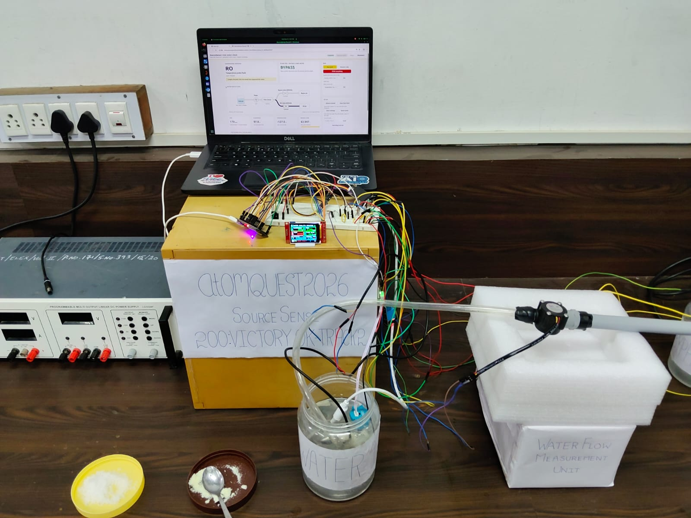
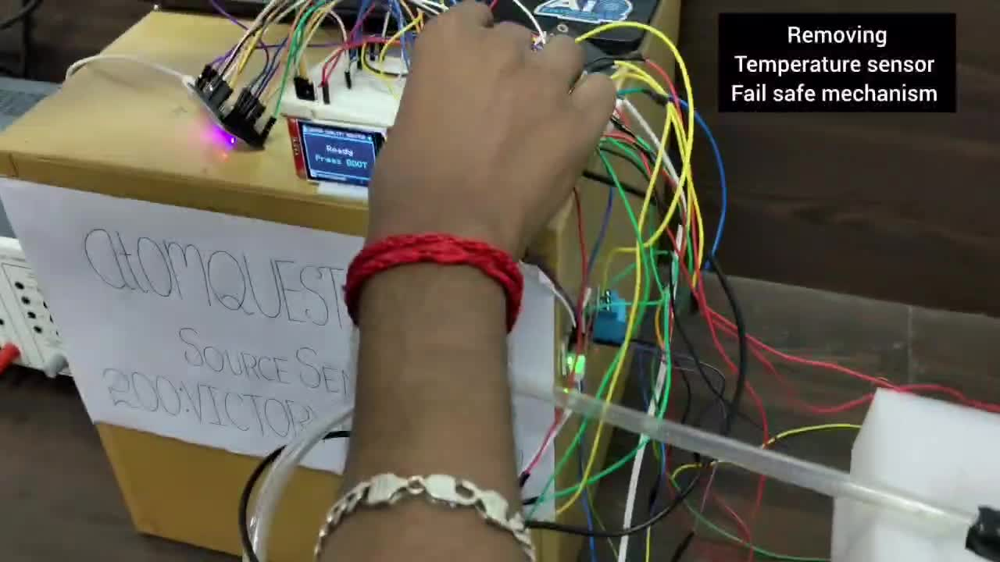
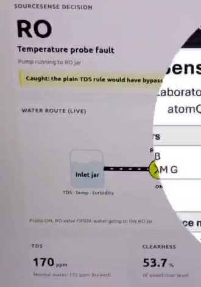
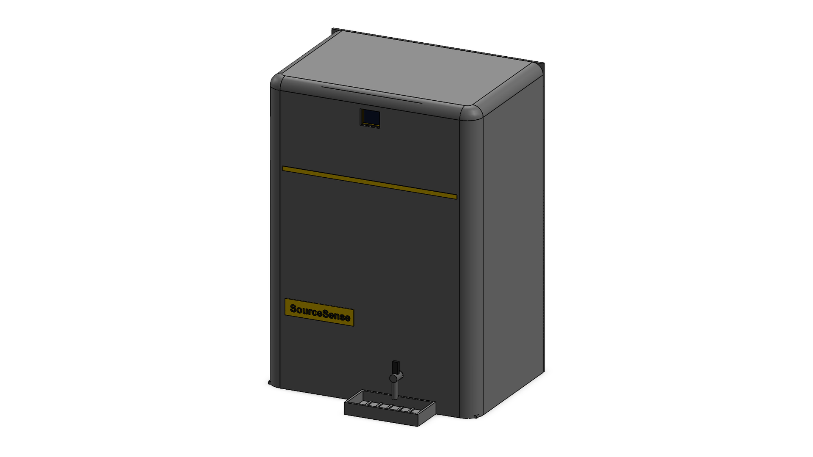

# SourceSense

Inlet water sensing beyond TDS, so that an adaptive water purifier knows when it is actually safe to skip RO.

**atomQUEST 2026 | Track 2: Water Purifier | Area: Input water quality sensing beyond TDS**
Team 200: Victory OK (SANMUGAVEL B, SANJEEVI SRIRAM G), Madras Institute of Technology, Anna University, Chennai

| Link | |
|---|---|
| **Round 3 video (final prototype)** | https://youtu.be/7ebfZ6pH9r4 |
| **Round 3 report (4 pages)** | [round3/report](round3/report/atomQUEST2026_200VictoryOK_MITAnnaUniversity_Track2_R3_Report.pdf) |
| **Signed lab record, MIT Chemistry Lab, 23-11-2026** | [round3/lab](round3/lab/SourceSense_MIT_Lab_Record_23Nov2026.pdf) |
| Live dashboard (needs the rig, or press Demo for simulated values) | https://sanmugavel1.github.io/SourceSense-atomQUEST2026/dashboard.html |
| SOLIDWORKS model in 3D (Round 2 bench model, opens in a browser) | https://sanmugavel1.github.io/SourceSense-atomQUEST2026/ |
| Round 2 video | https://youtu.be/Cdhpa81-0Cg |



## The problem

Adaptive purifiers skip RO when inlet TDS is below about 300 ppm. A TDS probe only measures conductivity, so a low reading does not mean safe water. In our lab test, nitrate at its 45 mg/L BIS limit raised the TDS reading by only 74 ppm (121 to 195 ppm). That water is still far below 300, so a TDS-only purifier sends it around the RO membrane. UF and UV do not remove dissolved ions like nitrate.

## The idea

SourceSense learns what this home's normal water looks like, then asks "is this still the same water?" before every cycle. RO is skipped only when every check passes. Any change, cloudy water, or a failed sensor goes to RO.

It does not need to identify nitrate. It only needs to notice that the water has changed, and RO removes it.

```
Measure          ->  Fault checks       ->  Hard limits             ->  Compare to normal water        ->  all passed: BYPASS
TDS (temp comp.)     sensor out of range     TDS > 280 ppm               rise > max(25 ppm, 20 %)           anything else: RO
temperature          -> RO                   cloudy > 1 NTU              fall > max(25 ppm, 30 %)
turbidity                                    tanker / no source tag      source tag changed
```

## Round 3: what the prototype does now

Water sits in the inlet jar with the TDS probe, DS18B20 and turbidity sensor. The ESP32 measures and decides, then drives three relays: the pump and two normally closed 12 V solenoid valves (RO path and bypass path). The pump runs a fixed 10 s per cycle through a YF-S201 flow sensor to the RO jar or the bypass jar. The decision and the reason show on the 1.8 inch TFT and on a Web Serial dashboard, next to what a plain TDS < 300 rule would have done with the same water.

### Results in the Round 3 video

Values read from the live dashboard in the video.

| Video | Water | TDS (ppm) | Clear (%) | SourceSense | Plain TDS < 300 rule | Reason on screen |
|---|---|---|---|---|---|---|
| 0:29 | Normal tap water | 176 | 98.0 | BYPASS | BYPASS | Matches this home's normal water |
| 1:12 | Same water + salt | 224 | 98.0 | **RO** | BYPASS | TDS rise above normal |
| 1:30 | + milk powder | 285 | 53.7 | **RO** | BYPASS | TDS above 280 ppm |
| 1:38 | Temperature probe pulled out (-127 C) | 170 | 53.7 | **RO** | BYPASS | Temperature probe fault |

Normal water was locked at 175 ppm for all these cycles.

**Target from our abstract:** no changed water should skip RO.
**Result:** every changed sample went to RO. The plain TDS rule would have bypassed all of them. This is only 4 recorded cycles, so we do not claim a percentage from it.

### Live fail-safe test

In the video (1:21 to 1:38) we pull the temperature sensor out during a run. The next cycle reads -127 C, the firmware marks it as a fault and the water goes to RO only. A fault can never cause a bypass. Both valves are normally closed, so with no power no water reaches either output.

| Temperature sensor pulled out | Result: RO, temperature probe fault |
|---|---|
|  |  |

### Lab validation (MIT Chemistry Laboratory, 23-11-2026)

Full signed record: [round3/lab/SourceSense_MIT_Lab_Record_23Nov2026.pdf](round3/lab/SourceSense_MIT_Lab_Record_23Nov2026.pdf)

| Check | Reference | Result |
|---|---|---|
| TDS probe on real water | Gravimetric TDS (evaporation at 180 C) | Within 4.3 % (tap 119 vs 121, borewell 539 vs 548, RO 34.5 vs 36) |
| TDS probe on standards | NaCl 50 to 500 mg/L | 2.0 to 3.3 % low, slope 0.972, R² = 1.000. Firmware now applies x1.029 |
| Nitrate spike | KNO3 added to tap water | +44.7 mg/L nitrate (BIS limit): 195 ppm. +89.4 mg/L: 266 ppm. TDS rule BYPASS both times, SourceSense RO |
| Temperature | Lab thermometer at 0, 27, 45 C | Within 0.2 C |
| Turbidity | Nephelometric turbidimeter | Clear % mapped to NTU. Cloudy limit set at 1 NTU (BIS) |

## What we changed since Round 2

| Round 2 | Round 3 | Why |
|---|---|---|
| Normal water slowly averaged in new readings | Learned from 3 matching samples, then locked in flash | In Round 2, 60 ppm then 95 ppm was still bypassed. A slow rise or a power cut could make it learn bad water as normal |
| Change rule: 25 % | Rise above max(25 ppm, 20 %) or fall below max(25 ppm, 30 %) | 25 % of soft water is inside probe noise, and too loose on hard water |
| Typed ORP value (MAN) | Source tag set once: corporation, borewell or tanker | No typed sensor values. Tanker always uses RO |
| Turbidity as relative clear % | Mapped to NTU from our lab readings, cloudy above 1 NTU | Lab showed 3.2 NTU was passing as clear |
| Pump on a hand switch | Pump on a relay, fixed 10 s run, stops on no flow, 60 s limit, 4 s watchdog | The ESP32 can always stop the water |
| Relays never switched on the first wiring | Found the relay modules are active HIGH, firmware fixed | GPIO test on 25-11-2026 |
| TFT with text lines | New 6-tile TFT layout and a new dashboard with live water route | Easier to read in a demo |

## Cost and power (details in the report)

- Prototype parts at online list prices: about Rs 3,100. We paid about Rs 3,500 in Round 2. No parts were bought in Round 3.
- Added cost per purifier at scale: about Rs 300 to 500 (temperature sensor, turbidity LED and photodiode, flow sensor, second valve). The purifier already has the TDS probe, controller and display.
- Power, calculated from part ratings (not measured): about 0.75 W idle, about 8.5 W while one valve and the pump are on.

## Known limitations

- TDS cannot tell which ion is present. SourceSense detects a change from normal water, not nitrate itself.
- Water that is already contaminated when it is learned is not caught, except by the 280 ppm hard limit.
- No ORP (chlorine) or 275 nm UV channel yet. We could not buy the ORP electrode (about Rs 4,000 alone) within our budget.
- The flow sensor was not calibrated with a measuring jug, so we do not quote litres.
- The power-cut test is designed (normally closed valves) but was not filmed.
- Bench rig only. This rig does not make drinking water.

## Next, with Atomberg mentors

1. Add a platinum ORP electrode: corporation water with no chlorine goes to RO. Our lab DPD test showed 0.35 mg/L on tap and below 0.02 mg/L on borewell and RO water.
2. Add a 275 nm LED and UV sensor: water with high organic load slows the pump to keep the UV dose. Tea raised A275 by 34 times at almost the same TDS in our lab.
3. Build the printed sensing head from our SOLIDWORKS design and fit it into a purifier.
4. Run it for weeks on real home water and train the decision on real readings.



*Final product concept in SOLIDWORKS. Not built yet, dimensions assumed.*

## Repository layout

| Folder | Contents |
|---|---|
| `firmware/SourceSense_R3` | **Round 3 firmware** used in the final video |
| `firmware/SourceSense_Manual_Pump` | Round 2 firmware |
| `firmware/Relay_Test` | Small sketch to check the relays |
| `dashboard/SourceSense_R3_Dashboard.html` | Round 3 Web Serial dashboard, one HTML file, no install |
| `round3/report` | Round 3 report (4 pages) |
| `round3/lab` | Signed MIT Chemistry Lab record |
| `round3/photos`, `round3/screens` | Rig photos and dashboard frames from the video |
| `cad/round3_final/solidworks` | **Round 3 SOLIDWORKS model**: 94 parts, 14 assemblies, drawing. Open `Assemblies/SS4_00_SourceSense.SLDASM` (configurations: Final_Product, Final_Product_Cutaway, Bench_Final, As_Built_R3). Keep `SS4_Globals.txt` and `SS4_Design_Values.txt` in the same folder; most sizes in them are marked ASSUMED |
| `cad/round3_final` | Exports of the same model: 8 images, 6-sheet drawing PDF, STEP, STL of printed parts |
| `cad/` (root) | Round 2 SOLIDWORKS bench model |
| `docs/` | Round 2 hardware notes, decision logic, test log, 3D viewer |

## Run it

1. Open `firmware/SourceSense_R3` in Arduino IDE. Board: ESP32 Dev Module. Libraries: Adafruit GFX, Adafruit ST7735 and ST7789, OneWire, DallasTemperature.
2. Pins: TFT CS 5, RST 4, DC 2, SCK 18, SDA 23. DS18B20 GPIO13. TDS power GPIO16, signal GPIO34. Turbidity GPIO35 (10k/20k divider). Flow GPIO27. Relays: RO valve GPIO26, bypass valve GPIO25, pump GPIO32 (active HIGH).
3. Open `dashboard/SourceSense_R3_Dashboard.html` in Chrome or Edge and press Connect, or use the Serial Monitor at 115200 baud, Newline.
4. First time: `s1`/`s2`/`s3` to set the source, `c` with RO or distilled water to save the clear level. Normal water is learned from the first 3 matching samples.
5. Press BOOT or type `n` to run a cycle. `q` measures without moving water, `x` stops everything, `i` shows settings.

The earlier figure of unsafe litres falling from 7.7 % to under 0.1 % comes from our Round 1 simulation of 1000 synthetic homes. It is not a hardware result.
