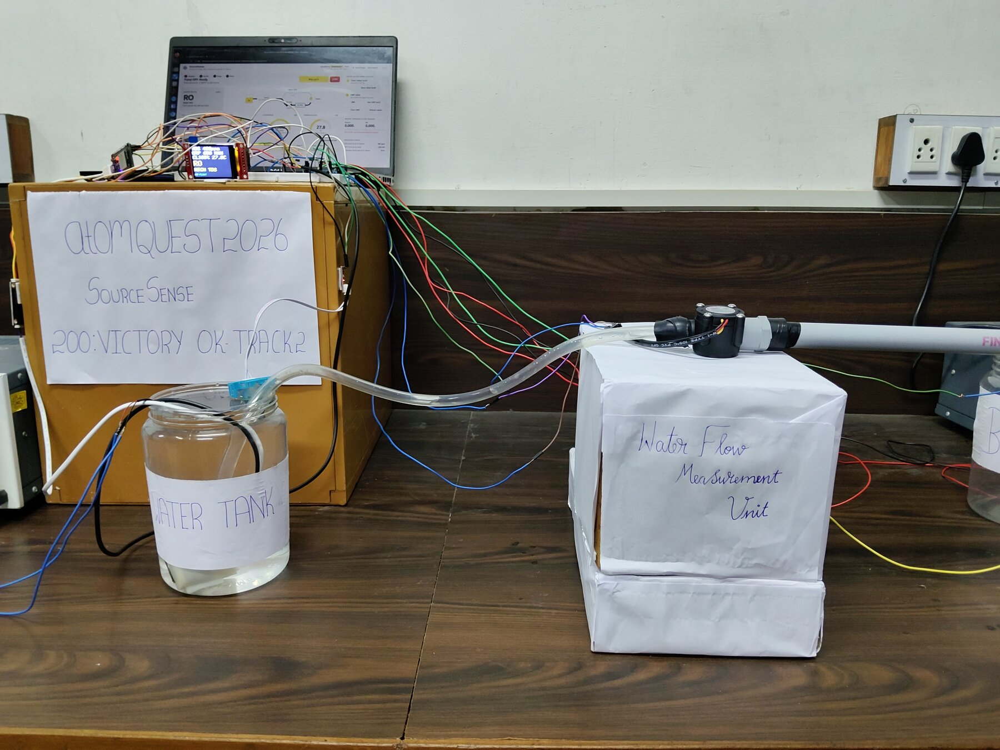
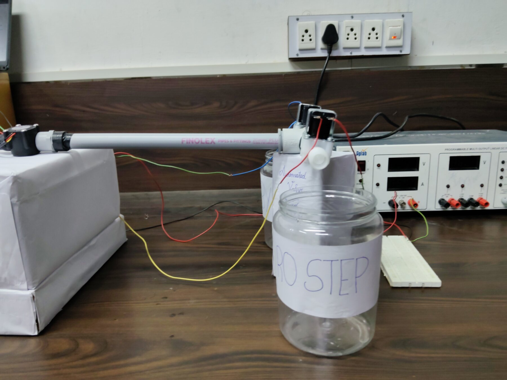
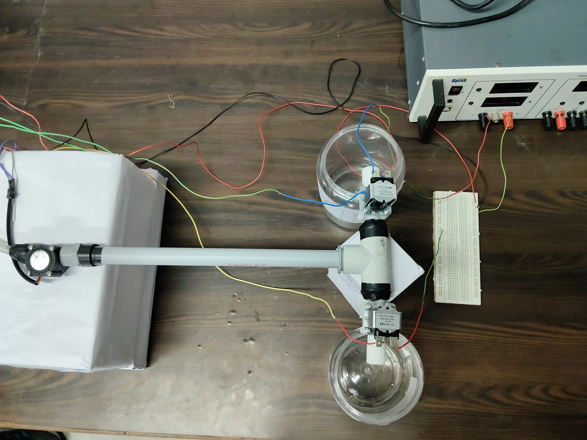

# Hardware

## Parts on the rig

| Block | Part | Job |
|---|---|---|
| Controller | ESP32 DevKit V1 | Reads sensors, decides, drives relays |
| Display | 1.8 inch ST7735 TFT | Readings, route and reason |
| Sensing | TDS board and probe | Conductivity, powered only while reading |
| Sensing | DS18B20 | Temperature, also corrects TDS |
| Sensing | Analog turbidity sensor | Relative clearness against a saved clear level |
| Water | Submersible mini pump, hand switch, external 5 V | Moves water. Not controlled by the ESP32 |
| Water | YF-S201 flow sensor | Counts pulses after the pump |
| Water | PVC line, tee, tubing | Splits the line to two valves |
| Routing | 2 x 12 V normally closed solenoid valves, relay module | RO path and bypass path |
| Power | Lab bench supply | 12 V for the valves |
| Laptop | USB serial | Power for the ESP32, dashboard |

## ESP32 connections

| Part | Pin or wire | Connect to | Notes |
|---|---|---|---|
| TFT | VCC, LED | 3V3 | |
| TFT | GND | GND | |
| TFT | CS, RST, DC | GPIO5, GPIO4, GPIO2 | |
| TFT | SDA, SCK | GPIO23, GPIO18 | |
| DS18B20 | Red, Black | 3V3, GND | |
| DS18B20 | Yellow | GPIO13 | 4.7 k to 3V3 |
| TDS board | + | GPIO16 | The pin powers the board |
| TDS board | - | GND | |
| TDS board | A | GPIO34 | Direct |
| Turbidity | VCC, GND | VIN (5 V), GND | |
| Turbidity | S | 10 k, then GPIO35 | 20 k from GPIO35 to GND |
| YF-S201 | Red, Black | VIN (5 V), GND | |
| YF-S201 | Yellow | 10 k, then GPIO27 | 20 k from GPIO27 to GND |
| Relay module | VCC, GND | VIN (5 V), GND | |
| Relay module | IN1 | GPIO26 | RO valve |
| Relay module | IN2 | GPIO25 | Bypass valve |
| Button | BOOT | GPIO0 | On the board, starts a cycle |

The two dividers bring 5 V signals down to about 3.3 V, because ESP32 inputs are not 5 V tolerant.

## Valve wiring

12 V from the bench supply goes through the relay COM and NO contacts to the valve. Each valve has a flyback diode across its coil. With no power the valves stay shut, so nothing dispenses.

## Water path

Tank jar, pump, flow sensor, tee, then RO valve to the RO jar or bypass valve to the bypass jar. Electronics sit on a raised box behind the water parts.

## Photos

